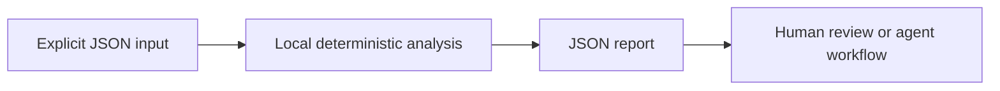

<div align="center">


[](https://github.com/XingCEO/patch-scope-guard/actions/workflows/ci.yml)

[](LICENSE)


**Give coding agents a reviewable boundary for every proposed patch.**

[Try it](#quickstart) · [Input contract](#input-contract) · [Example report](examples/output.json) · [Contribute](CONTRIBUTING.md)

</div>

## The problem

A coding agent may solve the requested bug while also touching release workflows or generated files. A changed-file list alone misses rename sources and unusually large edits.

## How it works

Parse ordinary Git unified diffs and evaluate both old and new paths against explicit allow/deny globs, protected path rules and a line-change budget. Renames are checked on both sides, binary changes are surfaced and traversal paths are rejected. The tool only inspects the diff.



## Quickstart

Requires Python 3.11 or later. The analyzer has **no runtime dependencies**, makes no network requests and runs no shell commands. Domain-specific interpretation (such as SQL rehearsal) is described below.

```bash
git clone https://github.com/XingCEO/patch-scope-guard.git
cd patch-scope-guard
python3 -m patch_scope_guard examples/input.json
```

Optional installation into an isolated environment:

```bash
python3 -m venv .venv
. .venv/bin/activate
python -m pip install .
patch-scope-guard examples/input.json
```

The package is installed from this checkout; no PyPI publication is claimed.

## Input contract

Use [the complete example](examples/input.json) as a starting point. Paths and strings in JSON are data unless the contract explicitly says they refer to local files.

| Field | Meaning |
| --- | --- |
| `diff` | A standard `git diff --no-ext-diff --no-color` string. |
| `allow / deny` | Lists of fnmatch patterns; deny wins. Default allow is all paths. |
| `max_changed_lines` | Nonnegative total addition-plus-deletion budget, default 500. |

## Example result

Generated by running the committed example:

```json
{
  "changed_lines": 4,
  "files": [
    {
      "added": 1,
      "binary": false,
      "deleted": 1,
      "new": "src/cache.py",
      "old": "src/cache.py"
    },
    {
      "added": 1,
      "binary": false,
      "deleted": 1,
      "new": ".github/workflows/ci.yml",
      "old": ".github/workflows/ci.yml"
    }
  ],
  "findings": [
    {
      "path": ".github/workflows/ci.yml",
      "reason": "outside_allowlist"
    },
    {
      "path": ".github/workflows/ci.yml",
      "reason": "denied_path"
    }
  ],
  "within_scope": false
}
```

## Use from another tool

```python
import json
from patch_scope_guard import analyze

with open("examples/input.json", encoding="utf-8") as stream:
    report = analyze(json.load(stream))
```

`analyze(data)` returns a JSON-serializable dictionary. The CLI accepts `-` for stdin, writes reports to stdout and input errors to stderr. Exit `0` means analysis completed, including reports containing findings; exit `2` means invalid input or an unreadable file. Gate CI on the report's documented fields, rather than assuming exit `0` means no findings. The JSON report is a v0.1 interface and may evolve before 1.0.

## Validation

```bash
python3 -m unittest discover -v
```

Tests cover the example, malformed CLI input, and the domain-specific boundary cases in [tests/test_core.py](tests/test_core.py). CI also installs the package and runs its console entry point on Python 3.11 and 3.13. Test success demonstrates these cases; it is not evidence of production deployment.

## Scope and limits

Accepts standard Git text diffs, including quoted paths, additions, deletions and renames. Combined merge diffs are rejected. This is scope checking, not code correctness or secret scanning. Globs use Python fnmatch semantics: * can match slashes. Line budgets count added plus deleted lines.

This is a focused experimental first release. Review findings before changing production systems. Inputs and reports may contain your own source or metadata; keep them in an appropriate local workspace.

## Related work and references

- [Git diff format](https://git-scm.com/docs/diff-format)
- [Python fnmatch semantics](https://docs.python.org/3/library/fnmatch.html)

These projects and specifications inform the problem space. This repository is an independent implementation; it does not claim to replace the referenced systems or to have invented the underlying techniques.

## Contributing

A small real-world fixture with expected behavior is the most useful contribution. See [CONTRIBUTING.md](CONTRIBUTING.md). Please remove private data before filing an issue.

## License

[MIT](LICENSE) © 2026 XingCEO.
