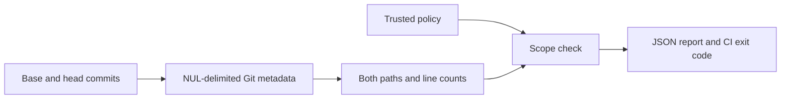

<div align="center">


[](https://github.com/XingCEO/patch-scope-guard/actions/workflows/ci.yml)

[](LICENSE)


**An agent fixed your cache. Did it also change your release workflow?**

Check both sides of every Git rename, protected paths, binary changes and a line budget before merging a committed patch.

[Quickstart](#quickstart) · [CI usage](#use-in-ci) · [Policy](examples/policy.json) · [Example report](examples/output.json)

</div>

## Why this exists

A path allowlist can miss the source of a rename. A patch reader can confuse quoted filenames or count a line that looks like `+++` as a file header. A command that always exits successfully cannot enforce a CI boundary.

Patch Scope Guard compares **two immutable local Git commits** using NUL-delimited raw metadata and line statistics. It reports policy violations as JSON and can fail a CI check. No source code is evaluated, and Git external diff commands and textconv filters are explicitly disabled.



## Quickstart

Requires Python 3.11+ and Git 2.31+. The implementation uses the Python standard library. Native Git mode targets Linux and macOS. CI targets Linux; local validation uses macOS, Python 3.14 and Git 2.54.

```bash
git clone https://github.com/XingCEO/patch-scope-guard.git
cd patch-scope-guard
python3 -m venv .venv
. .venv/bin/activate
python -m pip install .

# Compare the last two commits in another local repository.
patch-scope-guard --repo ../your-project --base HEAD~1 --head HEAD \
  --policy examples/policy.json --check
```

`--base` is required in Git mode; `--head` defaults to `HEAD`. Branch names, tags and revision expressions resolve to commit object IDs before either diff command runs. The tool compares exactly `base` to `head`; it does **not** calculate a merge base or inspect uncommitted changes. Use the intended merge-base commit explicitly for pull requests.

To try the committed synthetic example without Git access:

```bash
python3 -m patch_scope_guard examples/input.json
# This example deliberately violates policy; --check returns 1.
python3 -m patch_scope_guard examples/input.json --check
```

Installation is from this checkout; no PyPI publication is claimed.

## Use in CI

Install the tool from a pinned release or commit, fetch the desired history, and supply trusted policy and immutable base/head IDs. A pull request should not be able to loosen the policy used to evaluate itself. This example assumes the CLI is already installed:

```yaml
- uses: actions/checkout@v4
  with:
    fetch-depth: 0
- name: Check patch scope
  env:
    BASE_SHA: ${{ github.event.pull_request.base.sha }}
    HEAD_SHA: ${{ github.event.pull_request.head.sha }}
  run: >-
    patch-scope-guard --repo . --base "$BASE_SHA" --head "$HEAD_SHA"
    --policy /trusted/patch-policy.json --check
```

The report always goes to stdout. Diagnostics go to stderr.

| Exit | Meaning |
| --- | --- |
| `0` | Analysis completed; without `--check`, findings still return `0`. With `--check`, all checks passed. |
| `1` | `--check` was supplied and findings require review. |
| `2` | Invalid arguments, policy, revision, unsupported input or Git failure. No success report is emitted. |

## Policy contract

[examples/policy.json](examples/policy.json) is a standalone Git-mode policy. It contains only these fields; unknown fields and duplicate JSON object keys are rejected to catch misspelled or ambiguous rules.

| Field | Default | Meaning |
| --- | --- | --- |
| `allow` | `["*"]` | List of allowed path patterns. An empty list allows no changed path. |
| `deny` | `[]` | List of protected path patterns. Deny takes precedence. |
| `max_changed_lines` | `500` | Nonnegative integer budget for total additions plus deletions. |

Patterns use case-sensitive **Python `fnmatch` semantics**. `*` matches slashes; `src/*` includes nested paths. There is no Gitignore syntax, negation, or special recursive `**` behavior. Names are matched exactly as UTF-8 strings with no Unicode normalization. Both old and new paths are checked even for a pure rename or a deletion.

The report retains `within_scope`, `changed_lines`, `files` and `findings` from v0.1. Git-mode files additionally include `status`, `old_mode` and `new_mode`; `comparison` contains the resolved commit IDs. Mode fields are also preserved when present in text-mode metadata. Git uses the same old/new name for additions and deletions, with `A` or `D` identifying the operation. Line counts for binary files are zero and `binary_requires_review` prevents them from silently passing a line budget. Gitlink creations, deletions and updates produce `submodule_requires_review`.

Spaces and Unicode filenames are handled through NUL records. Tabs, newlines, ASCII control characters, backslashes and traversal paths are identified without splitting them and produce `unsafe_path`. Paths must use their canonical relative POSIX spelling: redundant separators, `.` components and trailing separators also produce `unsafe_path`, preserving the original spelling in the report. This prevents a noncanonical text patch from bypassing a rule for the actual target path. Invalid UTF-8 filenames are rejected with exit `2`.

## Python API

```python
from patch_scope_guard import analyze_repo

report = analyze_repo(
    "/path/to/repo",
    base="HEAD~1",
    head="HEAD",
    policy={"allow": ["src/*", "tests/*"], "deny": ["src/secrets/*"],
            "max_changed_lines": 200},
)
if not report["within_scope"]:
    print(report["findings"])
```

`analyze_repo` raises `ValueError` for unsupported or invalid Git metadata and revisions; operating-system failures may raise `OSError`. Each Git subprocess has a 60-second timeout. The tool passes arguments directly to Git without a shell and clears inherited `GIT_*` routing/configuration variables so they cannot select an unexpected repository. Local repository configuration is otherwise honored except where explicitly overridden (external diff, textconv, relative path filtering, submodule ignore settings, fsmonitor and hooks).

The compatibility API `analyze({"diff": "...", ...policy})` and JSON/stdin CLI still work. **Text mode is a deliberately strict subset**: unquoted ASCII paths without whitespace, matching file headers, complete standard hunks, simple rename/mode metadata and existing-file `Binary files … differ` notices. Combined diffs, quoted/escaped names, binary patch payloads, unknown extensions and malformed/truncated hunks are rejected. Use native `--repo` mode for actual Git changes. Supplied text is a caller-provided description, not proof that it matches any repository.

## Verification

```bash
python3 -m unittest discover -v
patch-scope-guard --repo . --base HEAD --head HEAD --check
```

The test suite creates real temporary Git repositories and checks rename-source protection, tab/newline/Unicode names, deletions, empty files, binary files, modes, symlinks, submodules, non-UTF-8 tree entries and revision errors. A hostile diff/textconv fixture verifies its helper is never executed. Further tests check truncated or inconsistent raw/numstat records, strict text hunks, policy validation and CLI exit codes. CI installs the package and runs the native adapter and test suite on Python 3.11 and 3.13.

## Scope and limitations

This is an experimental patch boundary checker. It does not establish code correctness, detect secrets, verify dependencies, apply patches, sandbox Git, or authorize merging. The local Git executable and repository object database must be trusted. Rename detection follows Git's similarity heuristic with a 1,000-candidate limit; a missed rename becomes a deletion and addition, and both paths remain checked. Binary classification and line counts follow Git attributes, including files explicitly marked as text. An empty, mode-only or pure rename change has a zero line cost but is still subject to path policy. Submodule contents are not recursively inspected.

No universal claim about arbitrary diff formats or filesystem encodings is made. Windows is not currently covered by CI. A policy violation requires review even if the underlying code change is correct.

## References and contributing

- [Git raw and numstat formats](https://git-scm.com/docs/diff-format)
- [Git diff options](https://git-scm.com/docs/git-diff)
- [Python fnmatch semantics](https://docs.python.org/3/library/fnmatch.html)

This is an independent implementation. Contributions should include a small synthetic fixture and expected report; see [CONTRIBUTING.md](CONTRIBUTING.md).

[MIT](LICENSE) © 2026 XingCEO.
